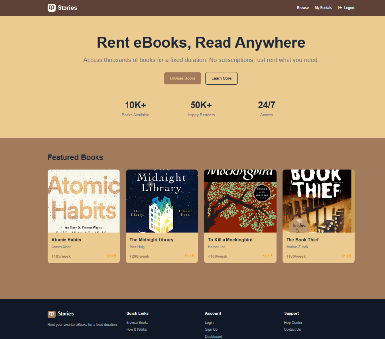
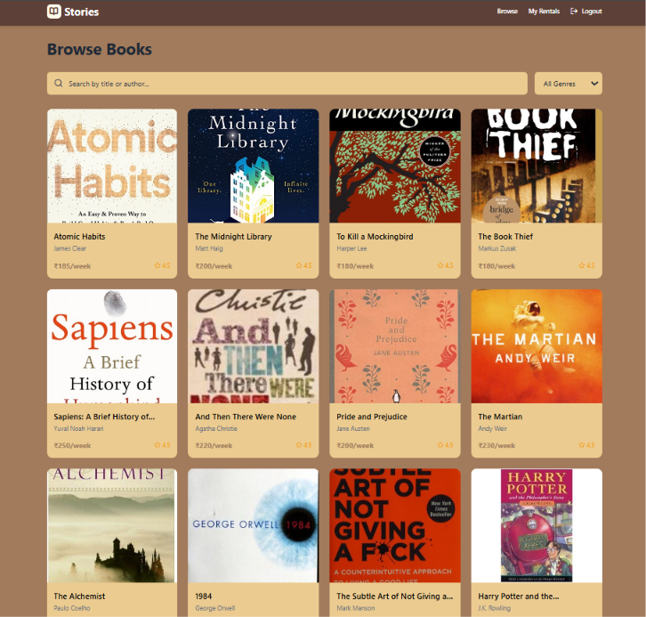
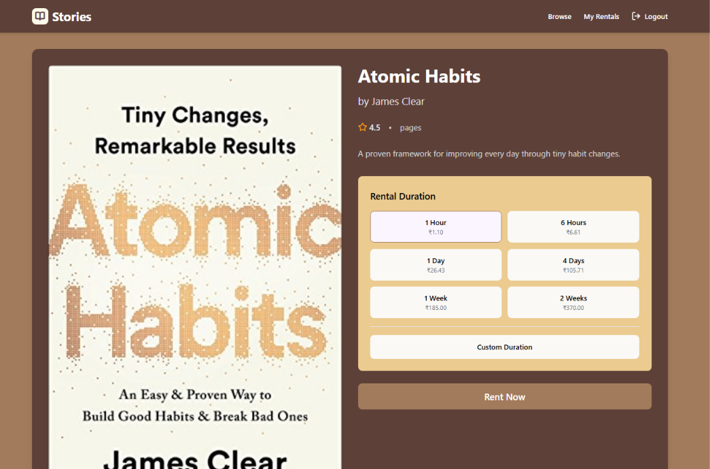
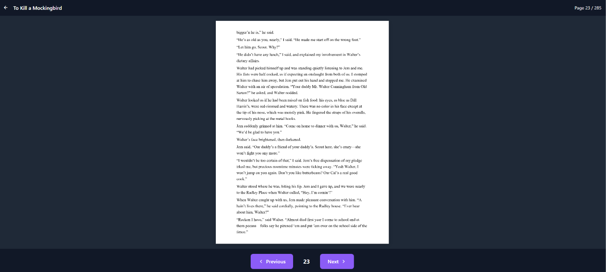
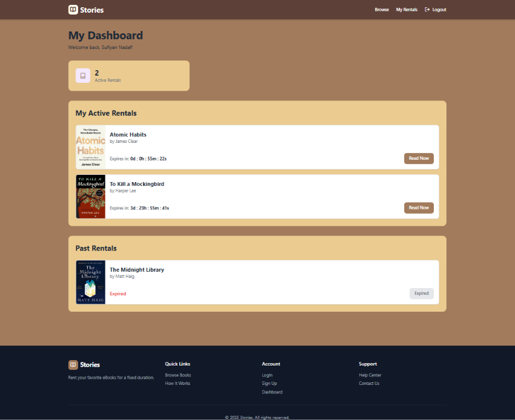

# 📚 E-book Rental Platform

A full-stack web application for discovering books, managing rentals, and reading digital books through an online reading interface.

## 📌 Overview

The E-book Rental Platform is a web-based application developed to simplify the process of browsing and renting digital books. It combines a user-friendly frontend with a backend API and MongoDB database to support authentication, book management, rental operations, and digital reading.

This project demonstrates full-stack web development, REST API integration, database management, and the implementation of a browser-based reading experience.

## ✨ Features

- **User Authentication** — User registration and login.
- **Book Discovery** — Browse the available book catalogue.
- **Book Details** — View information about individual books.
- **Rental Management** — Manage book rental operations.
- **Digital Reading** — Access the application's PDF reading interface.
- **User Dashboard** — View account and rental-related information.
- **REST API** — Backend endpoints for authentication, books, rentals, and reading access.
- **Database Integration** — MongoDB integration using Mongoose.

*Features and access restrictions depend on the current implementation.*

## 🖥️ Screenshots

Screenshots of the application will be added here.

## 📸 Application Screenshots

### 1. Homepage
The main landing page of the platform.



### 2. User Authentication

| Sign Up | Login |
|---|---|
|  |  |

### 3. Browse Books
Explore the available book catalogue.



### 4. Book Rental
The book rental interface.



### 5. Digital Reading
The browser-based book reading interface.



### 6. User Dashboard
The user's dashboard and rental-related information.



## 🛠️ Tech Stack

### Frontend
- HTML5
- CSS3
- JavaScript

### Backend
- Node.js
- Express.js
- REST API

### Database
- MongoDB
- Mongoose

### Development Tools
- Git
- GitHub
- npm

*Update this list if your implementation uses additional technologies.*

## 📁 Project Structure

```text
Ebook-Rental-Platform/
├── Backend/
│   ├── middleware/
│   ├── models/
│   ├── routes/
│   ├── db.js
│   ├── index.js
│   ├── seed.js
│   ├── package.json
│   └── package-lock.json
│
├── Frontend/
│   ├── components/
│   ├── utils/
│   └── ...
│
├── screenshots/
├── .gitignore
└── README.md
```

## 🚀 Getting Started

### Prerequisites

- Node.js and npm
- MongoDB or access to a MongoDB database
- Git

### 1. Clone the repository

```bash
git clone https://github.com/Sufiyan-Nadaf/Ebook-Rental-Platform.git
cd Ebook-Rental-Platform
```

### 2. Install backend dependencies

```bash
cd Backend
npm install
```

### 3. Configure environment variables

Create a `.env` file inside the `Backend` directory.

For example:

```env
PORT=5000
MONGO_URI=your_mongodb_connection_string
```

Configure any additional environment variables required by your implementation.

**Never publish your real database credentials, API keys, or secrets.**

### 4. Start the backend

Check the `scripts` section of `Backend/package.json` for the configured startup command.

If a `start` script is available:

```bash
npm start
```

Otherwise, if the application is designed to run directly through `index.js`:

```bash
node index.js
```

### 5. Open the frontend

Run the frontend using the local development method supported by the project. Configure its API URL to match your running backend if necessary.

## 🔐 Security Notes

- Keep environment variables and credentials out of version control.
- Do not commit private PDF files or copyrighted books without the appropriate rights.
- Use appropriate authentication and authorization checks to protect rented content.
- Avoid running database-seeding scripts against production databases.

## 🔮 Future Improvements

- Real payment gateway integration.
- Improved rental expiry and renewal workflows.
- Enhanced PDF access controls.
- Automated backend and frontend testing.
- Responsive UI improvements.
- Deployment to a production hosting environment.

## 👨‍💻 Author

**Sufiyan Nadaf**

GitHub: [Sufiyan-Nadaf](https://github.com/Sufiyan-Nadaf)

## 📄 License

No open-source license has been specified for this repository. All rights are reserved by default, subject to applicable law and any third-party rights.